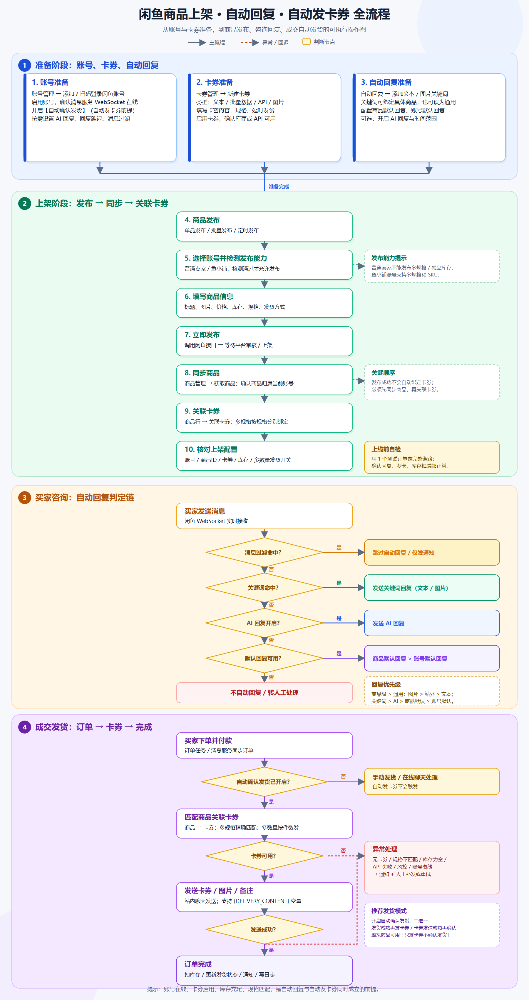
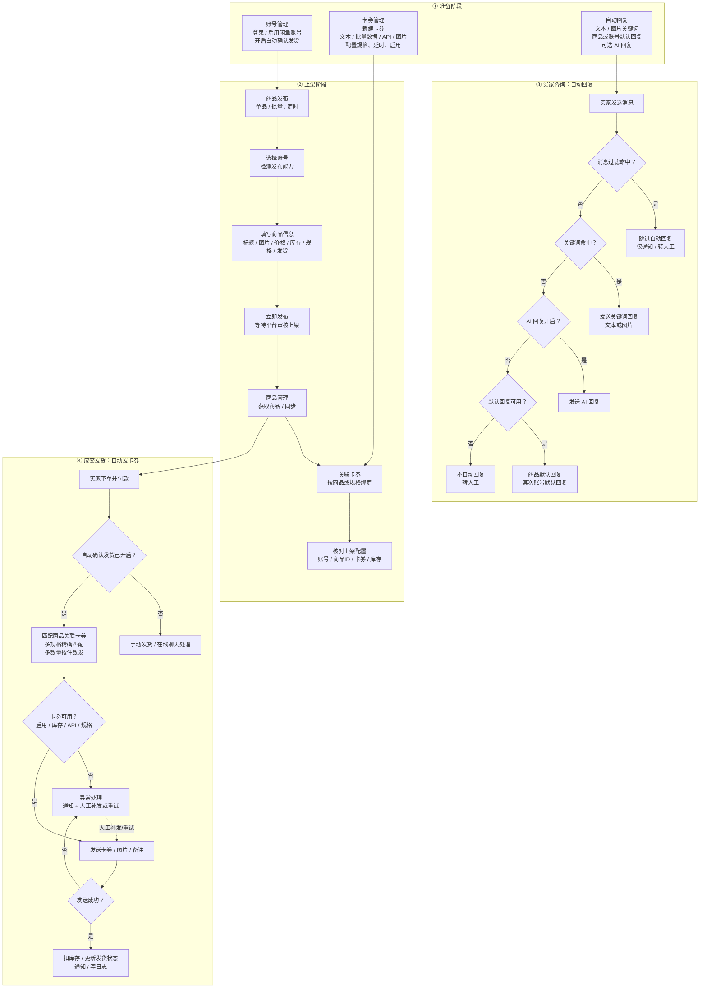

# 闲鱼商品上架 · 自动回复 · 自动发卡券流程图

> 适用：闲鱼自动回复管理系统（Docker 部署版）  
> 目标：把商品从 0 上架，并让买家咨询能自动回复、下单后能自动发卡券。



## 一、总流程



## 二、操作步骤

### 0. 前置检查

- 管理后台能正常登录。
- 闲鱼账号在「账号管理」中已登录、已启用。
- 账号的消息服务（WebSocket）在线；账号被禁用或离线时，自动回复和自动发货都不会工作。
- 卡券内容、库存或卡券 API 已经准备好。

### 1. 账号准备

进入 **账号管理**：

1. 添加账号或扫码登录闲鱼账号。
2. 确认账号状态为启用。
3. 打开 **自动确认发货**。  
   这是自动发卡券的前提；不开启时只能手动发货。
4. 按需设置：
   - AI 回复开关与时间段；
   - 自动回复延迟；
   - 人工发消息后暂停自动回复；
   - 消息过滤规则；
   - 定时补发货。

### 2. 卡券准备

进入 **卡券管理 → 新建卡券**：

1. 选择卡券类型：
   - 文本卡券；
   - 批量数据；
   - API 接口；
   - 图片卡券。
2. 填写卡券名称、发货内容、备注。
3. 非图片卡券如果填写备注，备注中必须包含 `{DELIVERY_CONTENT}` 变量。
4. 需要区分商品规格时，开启 **多规格卡券**，填写规格名称和规格值。
5. 设置 **延时发货时间**：0 表示立即发货，最大 3600 秒。
6. 保存后确认卡券为启用状态。
7. 批量数据卡券确认还有库存；API 卡券确认接口可正常返回；图片卡券确认图片已上传。

### 3. 自动回复配置

进入 **自动回复**：

1. 添加文本关键词：
   - 一行一个关键词；
   - 可绑定具体商品，绑定后只在该商品对话中生效；
   - 不绑定商品时是通用关键词。
2. 添加图片关键词：买家发送关键词时自动回复图片。
3. 回复内容留空表示“命中但不回复”，可用于屏蔽特定消息。
4. 配置默认回复：
   - 商品默认回复：商品管理 → 商品行 → 默认回复；
   - 账号默认回复：账号管理 → 默认回复。
5. 可选：在账号管理中开启 AI 回复，并设置生效时间段。

优先级从高到低：

```text
关键词 > AI 回复 > 商品默认回复 > 账号默认回复
```

同一范围内：

```text
图片关键词 > 站外联系方式关键词 > 文本关键词
商品级关键词 > 通用关键词
```

消息过滤命中时，会跳过关键词、AI、默认回复。

### 4. 发布商品

进入 **商品发布**：

1. 选择 **单品发布 / 批量发布 / 定时发布**。
2. 选择发布账号，等待系统检测发布能力。
3. 填写：
   - 标题、描述、图片；
   - 价格、库存；
   - 规格与 SKU；
   - 发货方式、运费、所在地。
4. 普通卖家账号不要使用多规格或独立库存；鱼小铺账号支持多规格。
5. 点击 **立即发布**，等待闲鱼平台审核并上架。
6. 到 **发布日志** 确认发布结果。

### 5. 同步商品并关联卡券

发布成功后，进入 **商品管理**：

1. 选择对应账号，点击 **获取商品**，把闲鱼商品同步到本地。
2. 找到刚上架的商品，确认商品归属账号正确。
3. 点击商品行的 **关联卡券**。
4. 选择卡券并保存：
   - 单规格商品绑定对应卡券；
   - 多规格商品按规格分别绑定；
   - 需要一次买多份发多张时，开启 **多数量发货**。
5. 核对：商品 ID、卡券、规格、库存、启用状态都正确。

> 重要：发布成功不会自动完成卡券绑定。必须先同步商品，再在商品管理里关联卡券。

### 6. 买家咨询：自动回复

买家发来消息后，系统按以下顺序处理：

1. 消息过滤：命中过滤规则则跳过自动回复。
2. 关键词：命中文本、图片或站外联系方式关键词，发送对应回复。
3. AI 回复：没有命中关键词且 AI 已开启，走 AI 回复。
4. 商品默认回复：没有 AI 时，优先使用该商品的默认回复。
5. 账号默认回复：商品没有默认回复时，使用账号默认回复。
6. 都没有配置时，不自动回复，转人工。

自动回复结果可在 **消息日志 / 自动回复日志** 中查看。

### 7. 买家下单：自动发卡券

买家付款后：

1. 系统同步订单。
2. 检查账号是否开启 **自动确认发货**：
   - 未开启：需要手动发货，不会自动发卡券；
   - 已开启：继续自动发货。
3. 按商品关联关系匹配卡券。
4. 校验卡券：
   - 卡券已启用；
   - 有库存或 API 可用；
   - 多规格订单的规格与卡券规格精确匹配；
   - 多数量订单按购买件数发多张。
5. 通过闲鱼聊天发送卡券内容、图片或备注。
6. 发送成功后：
   - 扣减库存；
   - 更新订单发货状态；
   - 发送通知；
   - 写发货日志。

发货模式在账号管理中按需选择：

| 模式 | 适用场景 |
|---|---|
| 发货成功再发卡券 | 先确认平台发货成功，再发卡券 |
| 卡券发送成功再确认发货 | 先发卡券，发送成功后再确认发货 |
| 只发卡券不确认发货 | 虚拟商品，只发卡券，不走确认发货 |

### 8. 异常处理

出现以下情况时，自动发货会失败或暂停：

- 商品没有关联卡券；
- 卡券被禁用；
- 批量数据卡券库存为空；
- API 卡券请求失败；
- 多规格订单规格不匹配；
- 闲鱼账号离线、Session 失效或触发风控；
- 聊天消息发送失败。

处理方式：

1. 查看 **订单管理 / 发货日志 / 风控日志**。
2. 补齐卡券、库存或重新启用卡券。
3. 恢复账号登录状态。
4. 在订单管理或在线聊天中人工补发。
5. 必要时使用定时补发货任务重试。

## 三、上线自检清单

- [ ] 闲鱼账号已启用，消息服务在线。
- [ ] 账号已开启自动确认发货。
- [ ] 卡券已创建、启用，库存或 API 正常。
- [ ] 商品已成功上架，并已同步到商品管理。
- [ ] 商品已关联正确卡券，多规格已按规格绑定。
- [ ] 需要多份发货的商品已开启多数量发货。
- [ ] 关键词、图片关键词、默认回复已测试。
- [ ] AI 回复开关和时间段符合预期。
- [ ] 消息过滤没有误拦截正常咨询。
- [ ] 用一个测试订单走完“咨询 → 下单 → 发卡券 → 扣库存”的完整链路。
- [ ] 确认订单、消息、发货日志都有记录。

## 四、常见问题

**商品发布成功，但商品管理里没有？**  
回到商品管理选择对应账号，点击“获取商品”同步。

**有咨询但不自动回复？**  
检查账号是否在线、消息过滤是否命中、关键词是否绑定到当前商品、默认回复是否启用。

**下单后没有自动发卡券？**  
优先检查账号的“自动确认发货”是否开启，再检查商品是否关联卡券、卡券是否启用、规格是否匹配、库存/API 是否正常。

**卡券发了但订单没发货？**  
检查账号的发货模式。使用“只发卡券不确认发货”时，平台订单不会自动确认发货。
